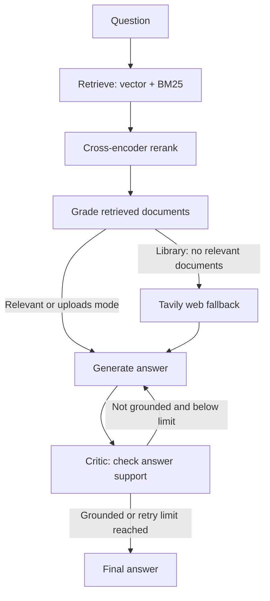

# Project Context

## What this project does

This is a Python 3.11 Self-Correcting RAG application for software architecture
documents. It retrieves passages, grades relevance, generates an answer, and
asks a critic node whether the answer is supported by its context. If the critic
rejects an answer, the graph can regenerate it within a fixed retry limit.

“Multi-agent” describes several LLM-driven nodes in one LangGraph workflow; this
is not a set of independently running agents.

## Architecture



`app/graph.py` defines the graph topology and `MAX_GENERATIONS = 2`. The
`retries` state value is incremented by the critic; when it reaches the cap,
the graph ends even if the answer is still ungrounded.

## Code map

- `app/graph.py` — LangGraph nodes, routing conditions, retry cap, and
  `initial_state(question)`.
- `app/state.py` — `GraphState`: question, retrieved documents, web-search
  flag, generated answer, grounded verdict, and critic retry count.
- `app/nodes.py` — model/client initialization, Gemini/Groq LLM helper,
  retrieval, relevance grader, Tavily fallback, answer generation, upload
  citation formatting, and hallucination critic.
- `app/common.py` — shared project paths and BM25 tokenization.
- `app/1_ingest.py` — reads PDFs in `data/`, builds hierarchical parent/child
  nodes, embeds child nodes in persistent ChromaDB, and stores parent nodes.
- `app/2_bm25_index.py` — builds the lexical index from the same leaf/child
  nodes and saves `local_storage/bm25_index.pkl`.
- `app/uploads.py` — validates uploaded PDFs and builds an in-memory
  `SessionIndex` for one Streamlit session.
- `app/ui.py` — Streamlit interface for library and uploaded-PDF modes; handles
  upload indexing, chat state, answer display, sources, and the mock-mode toggle.
- `app/api.py` — FastAPI library-mode API: `GET /health` and streaming
  `POST /ask` using Server-Sent Events.
- `data/` — source PDFs for the persistent library.
- `chroma_db/` and `local_storage/` — persistent vector and supporting index
  data generated by the ingest/index scripts.
- `.env` — local environment configuration. Never display, log, commit, or
  share its values.

## Retrieval and answer flow

### Library mode

The graph receives `config={"configurable": {"index": None}}`.

1. `nodes.py` gets vector candidates from ChromaDB and keyword candidates from
   BM25 (`TOP_K = 5` per retriever).
2. Candidate leaf chunks are reranked with a cross-encoder; the top three
   leaves are mapped to their parent context chunks.
3. The grader removes irrelevant documents. If none remain, the graph may use
   the Tavily web fallback.
4. The generator answers from the available context. Library-mode answer text
   is not passed through upload citation resolution.

### Uploaded-PDF mode

The graph receives the session's `SessionIndex` through
`config={"configurable": {"index": session_index}}`. Uploads are held in memory,
not added to the persistent library.

- `app/uploads.py` currently limits a session upload to three PDFs, 20 pages
  per PDF, and 10 MB per PDF.
- Each non-empty PDF page is a parent with a `[Source: filename, page N]`
  header. Text is split into overlapping child chunks for search.
- Summary requests sample pages per file. Comparison/coverage requests search
  and rerank passages per file so evidence is not all from one document.
- Upload mode does not use web fallback.
- During generation, retrieved excerpts receive `[E#]` IDs and source-group
  markers. The upload prompt instructs the model to cite excerpt IDs; code
  resolves those IDs to real filenames/pages before displaying the answer.
- `grade_generation` receives the original retrieved documents as its context,
  alongside the generated answer.

### LLM provider and mock mode

`nodes.call_llm()` uses Gemini by default and can use Groq according to
`LLM_PROVIDER`, quota/failure handling, and configured fallback models. The
provider settings are read from environment variables.

`MOCK_LLM=1` returns canned grader, critic, and answer output instead of making
LLM calls. The web-search node also skips Tavily in mock mode. Model and local
index initialization still occurs when `nodes.py` is imported.

## Running locally (PowerShell)

Run commands from the project root. The checked-out workspace contains a `venv`
directory; use its interpreter explicitly if the environment is not activated.

```powershell
# Build the persistent vector and parent-node store from PDFs in data\
.\venv\Scripts\python.exe app\1_ingest.py

# Build the BM25 index from the stored leaf nodes
.\venv\Scripts\python.exe app\2_bm25_index.py

# Start the Streamlit app
.\venv\Scripts\python.exe -m streamlit run app\ui.py

# Start the FastAPI server
.\venv\Scripts\python.exe -m uvicorn app.api:app --port 8000
```

The API is library mode only. Its ask endpoint accepts JSON such as
`{"question":"What is the Saga pattern?"}` and streams `node` events followed
by `final`, or an `error` event.

There is no root `requirements.txt`, `pyproject.toml`, or README in the
workspace as inspected when this context file was written. Do not assume the
dependency list or exact installed versions from this document.

## Environment and secret handling

Relevant environment-variable names observed in code:

- `GEMINI_API_KEY`, `GROQ_API_KEY`, `TAVILY_API_KEY`
- `GEMINI_MODEL`, `GROQ_MODEL`, `GROQ_FALLBACK_MODEL`
- `LLM_MODEL`, `LLM_FALLBACK_MODEL`, `LLM_PROVIDER`
- `MOCK_LLM`
- Optional tracing-related names may exist in local configuration; inspect
  code/manifests for current tracing implementation before relying on them.

Only document variable names, never local values. Keep `.env` private and
untracked.

## Important constraints for future changes

- Preserve graph topology, retrieval/chunking behavior, and grader prompts
  unless explicitly asked to change them.
- Keep library mode and upload mode behavior separate where appropriate.
- Do not let upload citation post-processing alter library answers.
- Preserve the no-relevant-passage shortcut: it returns a fixed response without
  a generator call; the critic skips checking it.
- Keep the critic's context as the original source excerpts, not a transformed
  or citation-rewritten substitute.
- In mock mode, do not introduce LLM, Tavily, or tracing network calls.
- Make narrow changes and validate the specific behavior changed. No
  project-level test suite was found during this inspection.

## Work status recorded here

- The API implementation and upload citation resolution are present in the
  current workspace.
- Langfuse integration was not found in the inspected code. Confirm the current
  task and installed Langfuse version before adding tracing.
- This file describes observed workspace state, not a guarantee that every
  dependency, model cache, credential, or local dataset is available on another
  machine.
