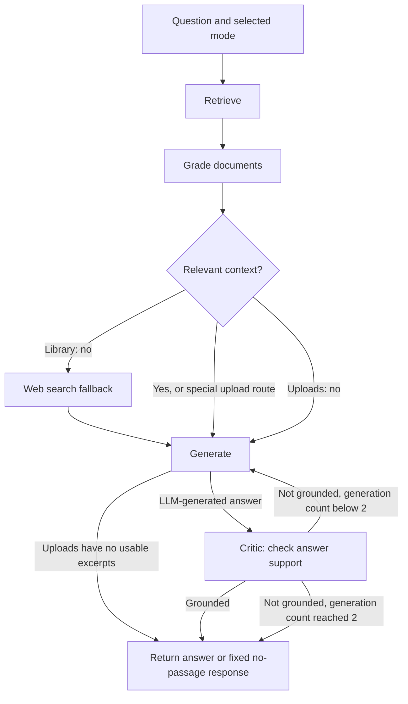

# Self-Correcting RAG

A local document question-answering project with a persistent architecture-paper
library and a separate, temporary mode for answering from PDFs you upload.

The project is **CRAG-style**: it grades retrieved material for relevance,
uses a corrective fallback in library mode, and verifies generated answers in a
critic loop. “Multi-agent” here means several LLM-driven nodes in one
LangGraph workflow; it does not mean a collection of independently deployed
agents.

## What it does

For a question, the system retrieves context, checks whether that context is
relevant, generates an answer, and asks a critic whether the answer is
supported by the supplied context. If the critic says no, the graph can
regenerate once. The retry cap is two total generations (the initial answer
plus at most one regeneration). If the final answer still is not grounded, the
best available answer is returned with its grounded status rather than being
silently treated as verified.

Two knowledge-source modes are available:

- **Library** searches the persistent local index. If retrieved passages are
  missing or all fail relevance grading, the workflow can try Tavily web
  search. Web results may then be used as answer context.
- **My PDFs / uploads** builds a per-session index from uploaded files and
  answers only from those PDFs. It does not use web search. When no useful
  passage is available, the generator returns an honest “no relevant passage
  was found” response instead of looking elsewhere.

## Architecture



In the diagram, “special upload route” refers to the summary, comparison, and
front-page (for example, author) paths. These select excerpts in a structured
way and skip the ordinary document relevance-grading call. If uploads mode has
no usable excerpts, the generate node returns a fixed “no relevant passage was
found” response without an LLM call.

## Retrieval and answer behavior

### Hybrid retrieval and parent/child chunks

For ordinary questions, the library and uploads modes combine two candidate
lists:

1. **Vector search** finds semantically similar child chunks.
2. **BM25** finds lexical matches.
3. Duplicate candidates are removed and a **cross-encoder** reranks the
   remaining child chunks.
4. The best-ranked children are mapped back to their larger parent context
   before generation.

The persistent library is built with hierarchical parent/child chunks: parent
nodes are about 1,024 tokens and child nodes about 256 tokens, with configured
overlap. Upload indexes use page-sized parent context and smaller overlapping
word-based child chunks. Search operates on the children; the generator gets
the corresponding parent/page context.

### Special upload routes

- **Summary / overview:** samples up to four pages per PDF, with a bounded
  amount of text per page, so a short summary request is not dependent on
  topic-specific search words.
- **Comparison / document coverage:** searches within each file, ranks
  candidates per file, and keeps up to five passages per file. This is
  intended to avoid a single global result list being dominated by one PDF.
- **Authors / front-page questions:** reads page 1 of each uploaded PDF.

These are routing heuristics, not exhaustive document analysis. See
[Known limitations](#known-limitations).

### Citations

In uploads mode, the model is given temporary excerpt labels such as `[E1]`.
Application code maps those labels back to the original PDF name and page
number, formats the citations, and removes leftover excerpt tags. The model
does not construct the final filename/page citations itself. Library citations
depend on the source metadata present in the indexed context.

## Language models and fallback

Gemini is the default provider. Configure `GEMINI_API_KEY` in the root `.env`
file. Set `LLM_PROVIDER=groq` and `GROQ_API_KEY` to use Groq directly; otherwise,
quota failures from Gemini can fall back to Groq when that key is configured.
`GROQ_MODEL` selects the Groq model. A separate `GROQ_FALLBACK_MODEL` can be
configured for a second Groq model attempt.

Library web fallback uses Tavily and requires `TAVILY_API_KEY`. Upload mode
does not invoke web search.

For local interface testing without LLM calls, set `MOCK_LLM=1` in the backend
process environment. Mock mode returns canned responses; it is not an
evaluation of answer quality. The application still needs its local indexes
and embedding/reranking models available.

## FastAPI API and streaming contract

The FastAPI application is `app.api:app`, normally served at
`http://localhost:8000`.

| Endpoint | Purpose |
| --- | --- |
| `GET /health` | Basic backend health check. |
| `POST /sessions` | Create an in-memory uploads session; returns `session_id`. |
| `POST /sessions/{session_id}/files` | Multipart PDF upload. The API accepts up to 3 PDFs, each at most 10 MB and 20 pages, and validates the `.pdf` extension and PDF signature. |
| `GET /sessions/{session_id}` | List accepted PDF names and page counts. |
| `DELETE /sessions/{session_id}` | Remove the session and free its index. |
| `POST /ask` | Ask a question in `library` or `uploads` mode and receive Server-Sent Events. |

`POST /ask` accepts JSON in this shape:

```json
{
  "question": "What is the Saga pattern?",
  "mode": "library",
  "session_id": null
}
```

For uploads, set `"mode": "uploads"` and supply a valid `session_id` containing
at least one accepted PDF. Each question is independent; the backend does not
keep conversational memory.

The `/ask` response uses these SSE events:

- `event: node` reports progress without full document text or answer content:
  - `retrieve`: `{"node":"retrieve","documents":N}`
  - `grade_documents`:
    `{"node":"grade_documents","kept":N,"web_search_needed":true|false}`
  - `web_search`: `{"node":"web_search"}` when the node runs
  - `generate`: `{"node":"generate","attempt":N}`
  - `grade_generation`: `{"node":"grade_generation","grounded":"yes"|"no"}`
- `event: final` contains `question`, Markdown `answer`, `grounded`,
  `critic_checks`, and `sources` (each source has a `library`, `web`, or
  `upload` type and a shortened text excerpt).
- `event: error` contains a redacted `message`.

Upload sessions exist only in process memory, are removed on backend restart,
expire after an hour idle, and are subject to a live-session cap. The API allows
CORS only from `http://localhost:5173` and `http://127.0.0.1:5173`.

## React frontend

The Vite + React + TypeScript frontend lives in [`frontend/`](./frontend/).
It provides a Library / My PDFs switch, upload session controls, streamed
pipeline progress, cancellation, Markdown/GFM answer rendering, citation
chips, and retrieved sources. The API base URL defaults to
`http://localhost:8000`; override it with `VITE_API_URL` in
`frontend/.env` if needed. The frontend polls `/health` every 25 seconds.

## Langfuse tracing and privacy

Tracing is optional. Configure `LANGFUSE_PUBLIC_KEY` and
`LANGFUSE_SECRET_KEY` in the root `.env`; `LANGFUSE_BASE_URL` (or
`LANGFUSE_HOST`) can select a non-default host. Missing keys or `MOCK_LLM=1`
leave tracing disabled. Tracing failures are intended not to interrupt the
answer path.

Traces include the request mode, request kind when recognized, question length,
final grounded status, critic checks, providers/models, latency, and available
token counts. Graph-node spans are recorded for the executed pipeline.

**Uploads privacy:** by default, uploaded question text, PDF excerpts/prompts,
and generated answers are not recorded as trace input/output. Upload traces
record metadata only; generation observations can include model/provider,
latency, excerpt count, and token usage. Session IDs and uploaded filenames
are not intentionally added to trace metadata. Set
`LANGFUSE_CAPTURE_CONTENT=1` only if you explicitly want to opt in to content
capture for uploads. This setting weakens the default privacy boundary, so use
it only when the uploaded content is appropriate for your Langfuse project.

## Windows setup and running locally

Use PowerShell from the project root. Python 3.11 is the tested runtime for
this workspace. Install the backend packages in a virtual environment:

```powershell
py -3.11 -m venv .\venv
.\venv\Scripts\python.exe -m pip install --upgrade pip
.\venv\Scripts\python.exe -m pip install fastapi uvicorn streamlit python-multipart `
  python-dotenv pypdf numpy chromadb rank-bm25 langgraph langchain-core `
  llama-index-core llama-index-vector-stores-chroma `
  llama-index-embeddings-huggingface sentence-transformers `
  google-genai groq tavily-python langfuse
```

The repository does not currently include a Python dependency lockfile or
requirements file; the install command above names the packages used by the
application and index scripts, but does not pin versions.

Create a root `.env` file and add the provider keys for the services you intend
to use. Keep the file private and do not commit it. For example, the variable
names are:

```dotenv
GEMINI_API_KEY=
GROQ_API_KEY=
TAVILY_API_KEY=
LLM_PROVIDER=gemini
GROQ_MODEL=
LANGFUSE_PUBLIC_KEY=
LANGFUSE_SECRET_KEY=
LANGFUSE_BASE_URL=
LANGFUSE_CAPTURE_CONTENT=0
```

If starting from an empty checkout, put the library PDFs you are authorized to
use in `data\`, then build the persistent indexes from the project root:

```powershell
.\venv\Scripts\python.exe app\1_ingest.py
.\venv\Scripts\python.exe app\2_bm25_index.py
```

The ingestion step downloads the configured embedding model if it is not
already cached. The application also loads the cross-encoder model on startup.
The generated `chroma_db\` and `local_storage\` indexes are local files and
should be rebuilt when the library corpus changes.

Start each interface in a separate PowerShell terminal from the project root:

**Terminal 1 — Streamlit**

```powershell
.\venv\Scripts\python.exe -m streamlit run app\ui.py
```

**Terminal 2 — FastAPI**

```powershell
.\venv\Scripts\python.exe -m uvicorn app.api:app --port 8000
```

**Terminal 3 — React**

```powershell
cd frontend
npm install
npm run dev
```

Open the Streamlit URL printed in its terminal (normally
`http://localhost:8501`) or the React application at
`http://localhost:5173`. To test the API/frontend without provider quota, set
mock mode in the backend terminal before starting it:

```powershell
$env:MOCK_LLM = '1'
.\venv\Scripts\python.exe -m uvicorn app.api:app --port 8000
```

From `frontend\`, run the frontend checks:

```powershell
npm test
npm run build
```

## Known limitations

- The critic checks whether answer claims are supported by the selected
  context; it does **not** check whether the answer is complete.
- Ordinary retrieval keeps only a small, globally ranked set of passages
  (currently up to three reranked child hits before mapping to parents). A
  relevant passage outside that retrieval depth may be missed.
- Comparison search is bounded per file and can keep several passages, but
  evidence is not guaranteed to cover every point in a long PDF. It deduplicates
  pages, so comparison results can contain at most one selected snippet per
  page.
- The author/front-page route reads only page 1 of each PDF. It can miss author
  information elsewhere in a document.
- Upload indexes and original upload bytes live in process memory. They are
  lost on restart and are not shared across multiple backend workers.
- Questions are independent; there is no chat memory or follow-up resolution.
- Scanned/image-only PDFs need OCR, which is not included.
- Library web search is a fallback, not a guarantee of current or comprehensive
  coverage. Search availability depends on Tavily configuration and network
  access.
- The answer may be returned as not fully grounded after the retry cap; the
  verification loop does not guarantee factual correctness.

## Screenshots

Add screenshots here when available:

<!-- Replace these placeholders with committed, non-sensitive screenshots. -->


